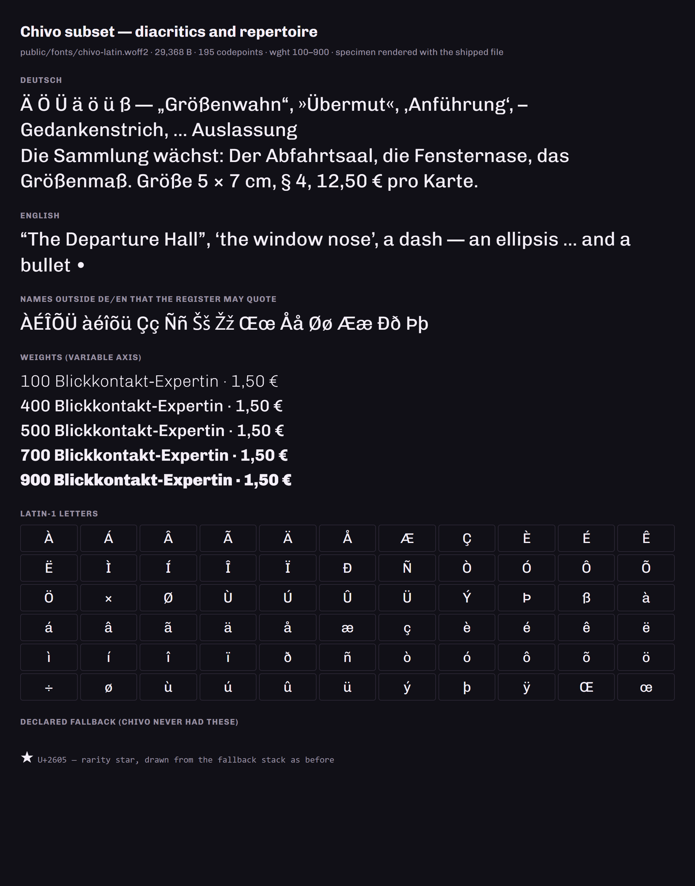

# I5b verification — Chivo subset inside the 30 KB ceiling

> Date: 2026-11-22 · Branch: `perf/i5b-chivo-subset` · Base: `origin/main` `846de1c` · Issue: **#35**
> Studio owner: `technical-artist` + `performance-analyst` · Cross-check: `cs-frontend-engineer`
> Skills: `perf-profile` (budget + measurement), `design-system` (type authority: art bible §8 is the
> budget of record), `test-driven-development` (gate written first and watched failing at 33,252 B),
> `verification-before-completion` (every number below is pasted command output),
> `writing-plans` (`docs/superpowers/plans/2026-11-22-i5b-chivo-subset.md`), `smoke-check` (build +
> gate set as the QA hand-off).

## 1. Result

| File | Before | After | Δ | Ceiling | Status |
| --- | ---: | ---: | ---: | ---: | --- |
| `public/fonts/chivo-latin.woff2` | 33,252 B | **29,368 B** | −3,884 B (−11.7 %) | 30,000 B | pass at 97.9 % |
| `public/fonts/ultra-latin.woff2` | 15,248 B | 15,248 B | — | 30,000 B | pass at 50.8 % |
| Shipped font total | 48,500 B | 44,616 B | −3,884 B | — | — |

Chivo headroom is 632 B. Budget is decimal — 30 KB = 30,000 B, the unit
`docs/build/b0-b1-verification.md` §4 used when it read 33,252 B as "33.25 KB, 10.8 % over".

## 2. Glyph coverage

| Measure | Before | After |
| --- | ---: | ---: |
| Codepoints mapped (cmap) | 227 | 195 |
| Glyphs in the font | 300 | 267 |
| Variable axes | `wght` 100–900 (default 500) | `wght` 100–900 (default 500) |

The repertoire is declared in `scripts/fonts.json` and regenerated by `npm run fonts:subset`:

- **ASCII printable** `U+0020–007E` — every UI control, digit and separator.
- **Latin-1 letters** `U+00C0–U+00FF` — DE/EN plus the Western-European names a museum register
  quotes (À É Î Õ Ç Ñ Š Ž Œ Å Ø Æ Ð Þ and their lower case), including `×` and `÷`.
- **DE/EN letters and marks used by the copy** — `Ä Ö Ü ä ö ü ß`, `§`, `«»`, `·`, `€`, `©`, `®`, `°`,
  `±`, `²`, `³`, `µ`, `¶`, `¡`, `¿`, `£`, `¢`, `¥`, NBSP.
- **Editorial typography** — `– —` (en/em dash), `‘ ’ ‚ “ ” „` (quotes), `‹ ›`, `…`, `•`, `™`, `−`,
  and the `Œ œ` ligature.
- **Declared fallback:** `U+2605 ★`, the rarity star in `src/lib/components/CardFace.svelte:54`, and
  `U+2715 ✕`, the close cross in `src/lib/components/CardDialog.svelte:58`. Chivo ships neither in any
  cut — the browser has always drawn them from the fallback stack, and this ticket does not change
  that. The gate prints each fallback line on every run so the declaration cannot rot silently.

Deliberately excluded (each with its reason in `scripts/fonts.json`): Latin-1 symbols with no
editorial use (generic currency, spacing diacritics, `ª º ¹ ¼ ½ ¾`, soft hyphen), upstream's
Vietnamese/Turkish/NFD helpers (`Ă ı ʼ ˆ ˚ ˜` and combining marks — the archive is NFC German and
English), and non-rendering punctuation (thin space, primes, fraction slash, BOM).

The gate also scans the shipped corpus — `index.html`, `src/**`, `photos/captions.json`,
`photos/captions.example.json` — and fails on any character Chivo cannot draw. Every character the
copy currently types is covered; the only characters outside the font are the two declared control
glyphs above, neither of which is DE/EN copy.

## 3. Rendered type is unchanged

Checked with fontTools against the pre-ticket file (`git show HEAD:public/fonts/chivo-latin.woff2`):

- **Outlines and advance widths:** all 195 kept codepoints compared at `wght` 100, 400, 500, 700 and
  900 — **0 mismatches** at every weight. Coordinates are identical, not merely similar.
- **Kerning:** 2,240 pairs before, 2,117 after; **0 pairs lost among kept glyphs** (the 123 dropped
  pairs all reference a removed glyph).
- **Variation:** `fvar` stays `wght` 100–900 / default 500, and `gvar` + `HVAR` are retained, so the
  weight axis still animates across the full range.
- **Layout features:** `GSUB` (`ccmp`, `dnom`, `frac`, `liga`, `locl`, `numr`, `pnum`, `tnum`) and
  `GPOS` (`kern`) survive, so ligature and figure behaviour is unchanged.

Diacritics specimen — rendered in a browser from the shipped file, not from a mock:
`docs/build/i5b-font-specimen.html` (source) and `docs/build/i5b-diacritics.png` (capture).



## 4. The gate (the ticket's third acceptance criterion)

`npm run gate:fonts` → `scripts/font-budget.mjs`. It is enforced in CI as its own named step —
`name: Font byte budget` · `run: npm run gate:fonts` — with its own `font-budget` entry in
`.github/gates.json` (**#99**, landed with #105 once the push token carried the `workflow` scope).
`tests/unit/font-budget.test.ts` keeps spawning the script against the real tree, so a regression is
red even in a run that skips the named step, the same mechanism the contrast gate uses. It fails when:

1. a shipped file is over the ceiling — **before** this ticket:
   `font-budget: public/fonts/chivo-latin.woff2 is 33,252 B — 3,252 B (10.8 %) over the 30,000 B ceiling`
   (exit 1);
2. a font under `public/fonts/` is not declared — a new webfont cannot dodge the ceiling;
3. a declared font is missing, or the manifest is malformed;
4. the shipped font no longer maps a declared codepoint, or a character used by the copy has no
   glyph and no declared fallback entry.

After the subset:

```
font-budget: public/fonts/chivo-latin.woff2 leaves U+2715 to the fallback stack (declared) at src/lib/components/CardDialog.svelte:58
font-budget: public/fonts/chivo-latin.woff2 leaves U+2605 to the fallback stack (declared) at src/lib/components/CardFace.svelte:54
font-budget: public/fonts/chivo-latin.woff2 29,368 B / 30,000 B (97.9 %) · 195 codepoints mapped · 195 declared
font-budget: public/fonts/ultra-latin.woff2 15,248 B / 30,000 B (50.8 %) · 214 codepoints mapped · 0 declared
font-budget: 2 font(s) within the 30,000 B ceiling
```

The Vitest wrapper `tests/unit/font-budget.test.ts` pins the negative cases: 33,252 B fails with the
ticket's own numbers, exactly 30,000 B passes, 30,001 B fails, an undeclared file fails, a missing
file fails. It was written and watched failing on the real tree before the font changed.

## 5. Regeneration is reproducible

- Source: `assets/fonts/chivo-latin-source.ttf` — the upstream Google Fonts Chivo latin variable cut,
  decompressed losslessly from the 33,252 B woff2 (300 glyphs, `wght` 100–900). Subsetting the shipped
  woff2 in place would be lossy: a glyph dropped once could never come back.
- Recipe: `npm run fonts:subset` → `scripts/font-subset.mjs` (HarfBuzz via `subset-font`, dev-only) →
  writes the file from the repertoire in `scripts/fonts.json` and fails if the result is over budget.
- Dev-only additions: `subset-font` 2.9.0, `fontverter` 2.1.0, `harfbuzzjs` 1.6.4, exact-pinned; the
  lockfile was regenerated with the repo's pinned npm 11.6.2. Nothing new ships to the browser.

## 6. Gates run on this tree

See the PR for the pasted gate output. Locally, the 14 enforced gates from `.github/gates.json` pass
except `unit`, which fails only on Windows-host tests unrelated to fonts (symlink creation needs
privilege, `%TEMP%` 8.3 short paths break a realpath assertion, one path-separator expectation). The
new `tests/unit/font-budget.test.ts` passes on this host; CI runs the same suite on Linux.

## 7. Not done here

- No copy, layout or `@font-face` change: the file name, `font-weight: 400 700` declaration and the
  `index.html` preload are untouched.
- `ultra-latin.woff2` is not regenerated — it is already at 50.8 % of the ceiling and has no vendored
  source. It stays budget-checked.
- The pending `budget` gate (#25) covers the photo rendition ceilings; this ticket adds the font
  ceiling only.
